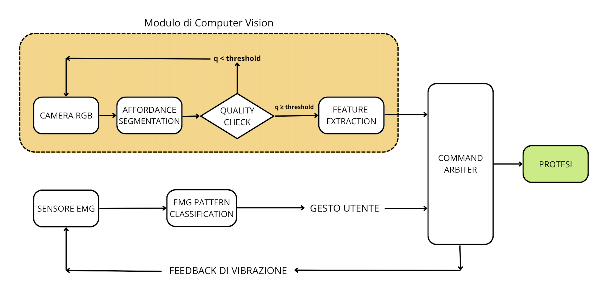
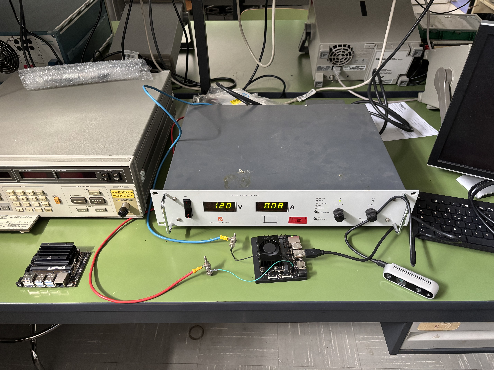
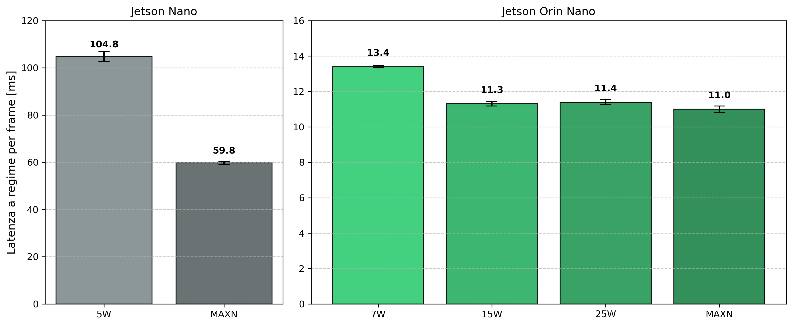
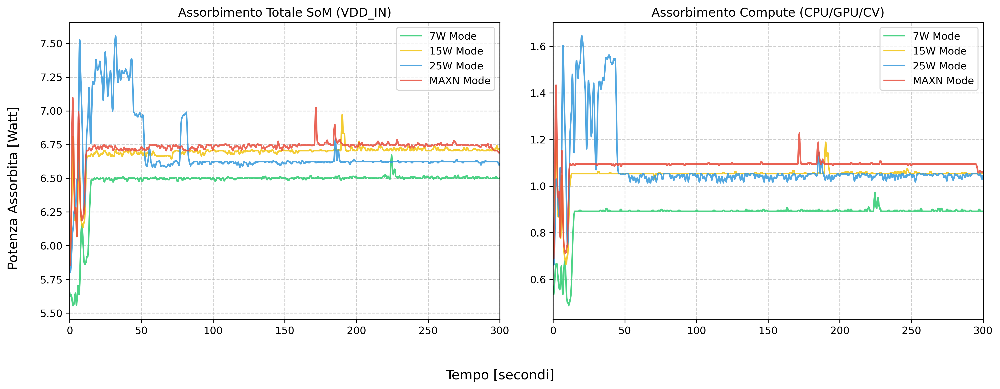

# Edge AI Deployment and SWaP Optimization for Wearable Robotics

**Disclaimer:** *The full source code for this project is private intellectual property of SEALab (University of Genoa) and cannot be publicly distributed. This repository serves as a technical showcase detailing the system architecture, deployment pipeline, hardware/software optimization challenges, and experimental benchmarks developed for my B.Sc. Thesis.*

## 1. Overview & Motivation

Upper-limb prostheses commonly rely on electromyographic (EMG) signals, imposing a high cognitive load on the user. A promising alternative is a **Shared Control** paradigm, where a Computer Vision module performs **Affordance Segmentation** on the target object to automate the *pre-shaping* phase of the robotic hand.

To meet real-time responsiveness, privacy, and reliability requirements without relying on cloud offloading, the inference model must run locally at the edge (**On-Demand Inference**). This project details the migration, optimization, and benchmarking of a lightweight Convolutional Neural Network (CNN) across two embedded hardware generations: the legacy **NVIDIA Jetson Nano** and the **NVIDIA Jetson Orin Nano**.

## 2. Hardware & Sensor Architecture

### Computing Platforms
* **Target Platform:** NVIDIA Jetson Orin Nano Developer Kit (Ampere architecture: 1024 CUDA cores, 32 Tensor Cores, unified RAM, JetPack 6.x / Ubuntu 22.04).
* **Baseline Platform:** NVIDIA Jetson Nano Developer Kit (Maxwell architecture: 128 CUDA cores, bare-metal legacy environment).

### Vision Sensors Integration
Two different camera sensors were integrated into the Python pipeline to evaluate current performance and future hardware miniaturization:
* **Intel RealSense D435i (USB):** Currently used in the prosthetic setup. Because precompiled `pip` packages lacked ARM64/CUDA support, `librealsense` was manually compiled from source via **CMake** on the Jetson, enabling CUDA acceleration and dynamic Python bindings (`.so`). Version `v2.55.1` was specifically checked out via Git to resolve protocol conflicts with the installed camera firmware.
* **Raspberry Pi Camera V2 (MIPI-CSI):** Integrated as a lightweight, low-power alternative (since the model uses RGB channels only). Required a 15-to-22 pin adapter and a low-level **Device Tree** modification via `jetson-io` to load the `IMX219` drivers and route raw data through the Jetson ISP via **GStreamer**.

## 3. Software Stack & Optimization Pipeline

Migrating the legacy codebase (originally built for Python 3.7 and CUDA 11) to JetPack 6.x (CUDA 12.x, OpenSSL 3.0) required rebuilding the entire software architecture:

1. **Framework Compatibility:** Upgraded to Python 3.10 and TensorFlow 2.16. To execute the pre-trained Keras 2 model without retraining, `tf_keras` was integrated using the `TF_USE_LEGACY_KERAS=1` environment flag.
2. **Model Acceleration (TF-TRT):** Converted the Encoder-Decoder CNN (128x128x3 input, skip connections, 3-class probabilistic output) using **TensorFlow-TensorRT**. Applied layer/tensor fusion, kernel auto-tuning, and **FP16 quantization** to leverage the Orin Nano's Tensor Cores while preserving segmentation mask accuracy.
3. **Unified Memory Management:** TensorRT profiling initially triggered `Segmentation Fault` errors due to the Jetson's shared CPU/GPU RAM. Resolved by disabling the OS graphical desktop (running purely *headless*) and explicitly capping TensorFlow memory (1 GB), TensorRT workspace (512 MB), and forcing Python garbage collection (`gc.collect()`) before compilation.
4. **Containerization (Docker):** Because NVIDIA discontinued local TensorFlow-TensorRT wheels for JetPack 6.x, the pipeline was encapsulated in a custom, stripped-down NVIDIA Docker container using `nvidia-container-runtime`. Hardware passthrough was achieved via `--device` and `--privileged` flags (for USB sensor resets), while the host-compiled `librealsense` binaries were injected via bind-mounting (`-v`) and overriding `PYTHONPATH` and `LD_LIBRARY_PATH`.

## 4. Experimental Methodology & Benchmarks

To ensure statistically robust metrics, latency and power consumption were evaluated under strict experimental conditions (headless OS, networking disabled):

* **Latency Profiling:** Separated **Cold Start** (script launch to first useful prediction, critical for *On-Demand Inference*) from **Steady-State Inference** (averaged over 500 frames after discarding a **20-frame warmup transient** required for CUDA context initialization and VRAM weight allocation).
* **Dual-Layer Power Profiling:** Measured internal SoM power rails (`VDD_IN` and `VDD_CPU_GPU_CV`) via Python polling the **INA3221** I2C sensors at 10 Hz (filtered with a 1-second moving average). Simultaneously validated **Total Board Power (TBP)** using an external stabilized bench power supply (12 V for Orin Nano, 5 V for Nano).

### Performance & Power Summary

| Platform | Power Mode | Cold Start [s] | Steady-State [ms] | SoM Power [W] | Total Board Power [W] |
| :--- | :--- | :---: | :---: | :---: | :---: |
| **Jetson Nano** | 5W | 742.7 | 104.8 | ~3.5 | ~7.0 |
| **Jetson Nano** | MAXN | 495.7 | 59.8 | ~5.5 | ~9.0 |
| **Jetson Orin Nano** | 7W | 11.5 | 13.4 | ~6.5 | ~10.8 |
| **Jetson Orin Nano** | 15W | 9.8 | 11.3 | ~6.7 | [10.8, 12.0] |
| **Jetson Orin Nano** | 25W | 10.4 | 11.4 | ~6.7 | [10.8, 12.0] |
| **Jetson Orin Nano** | MAXN | 9.3 | 11.0 | ~6.7 | ~12.0 |

## 5. Key Engineering Findings

* **Generational Speedup:** Comparing worst-case low-power profiles (5W vs. 7W), the Orin Nano reduced Cold Start latency by **98.5%** (64.6x faster, making on-demand prosthetic control viable) and Steady-State latency by **87.2%** (7.8x faster, eliminating the severe *power throttling* variance observed on the legacy 5W Nano).
* **Asymptotic Saturation (SWaP Trade-off):** Beyond the 15W mode on the Orin Nano, inference latency plateaus around 11.0–11.4 ms. Increasing the power budget to 25W or MAXN yields negligible speedup while wasting battery power.
* **SoM vs. TBP Discrepancy:** Experimental validation highlighted a 4.3 W to 5.3 W gap between internal INA3221 readings and bench measurements on the Orin Nano. Schematic analysis confirmed that internal sensors are blind to carrier board peripherals (USB hub, fan, level shifters) and Joule losses across the `GS9230` step-down voltage regulator—a critical factor for sizing wearable battery packs.
